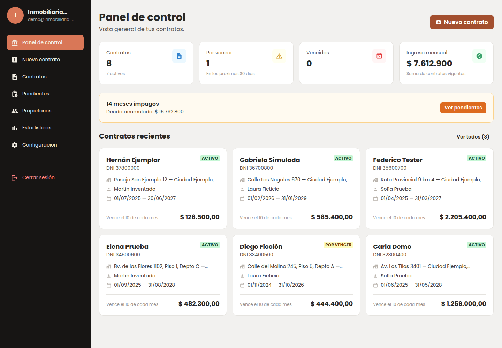
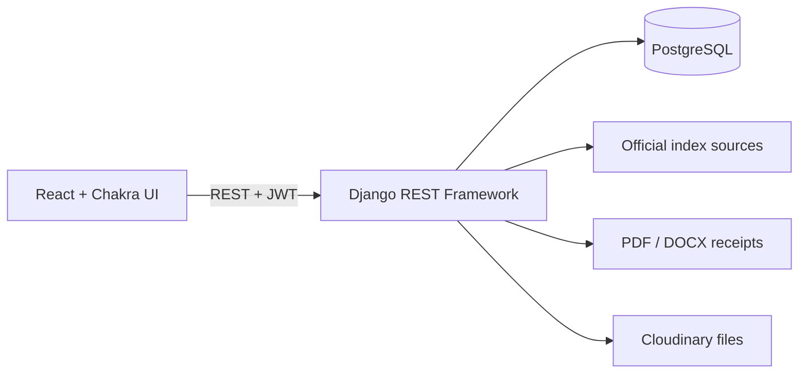
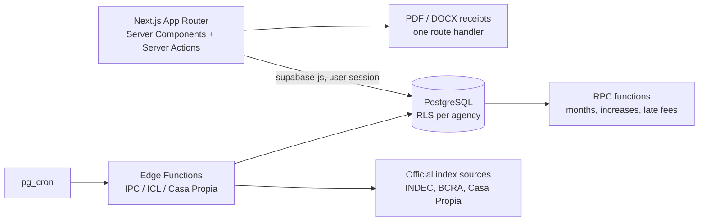
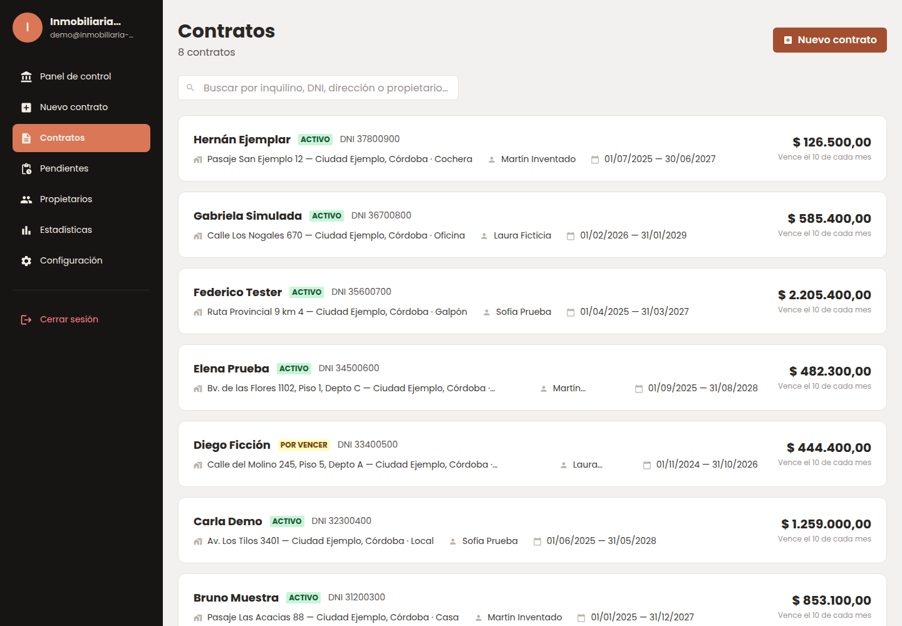
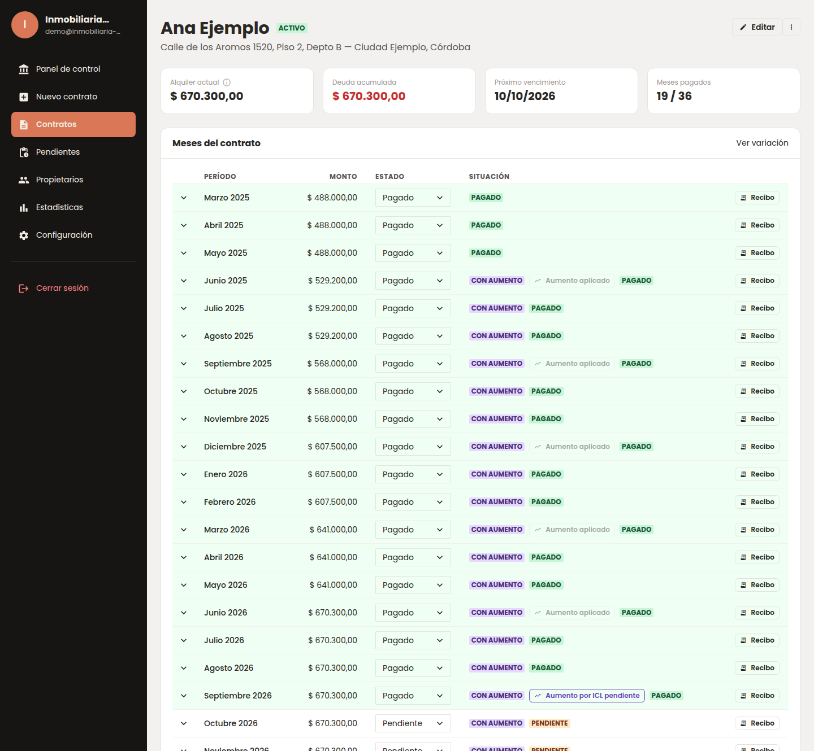
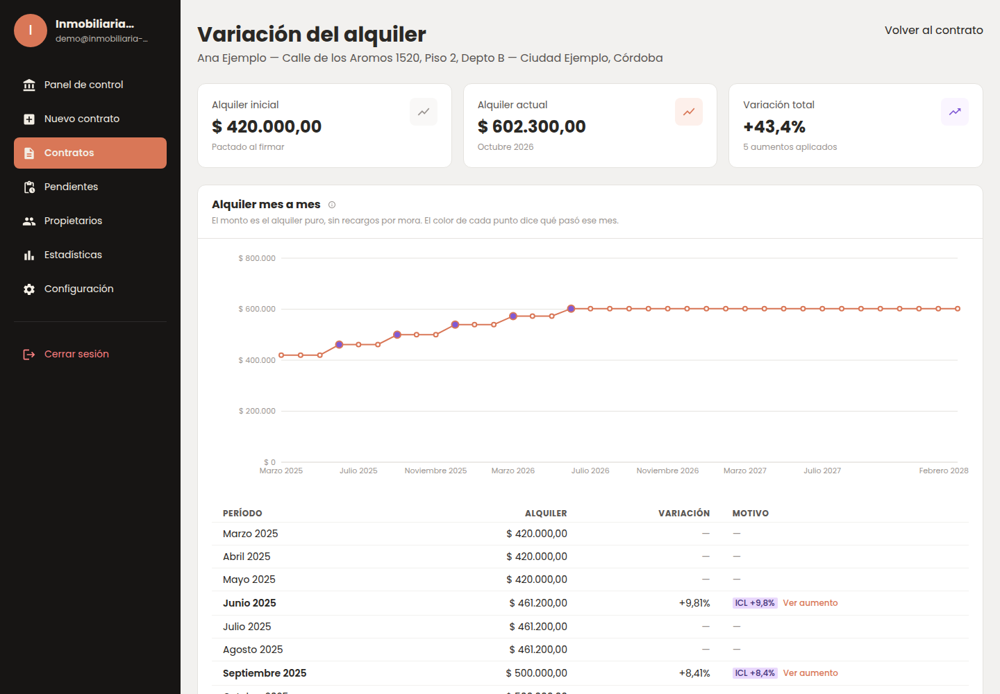
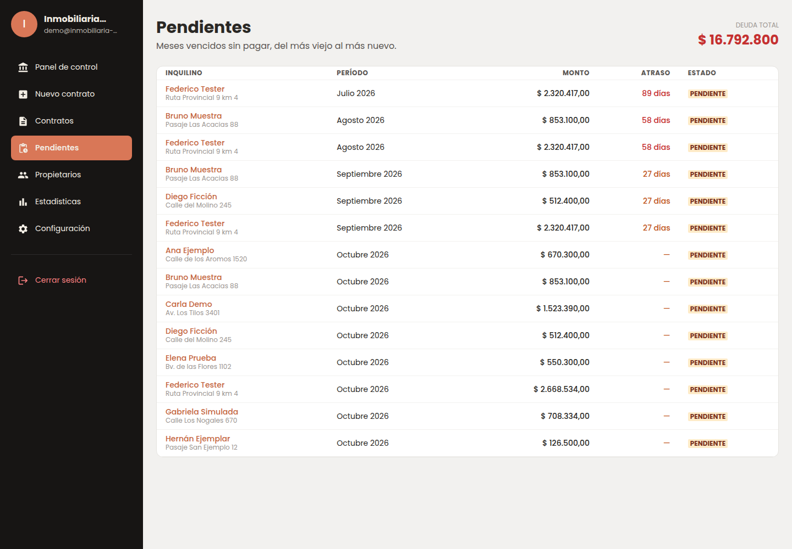
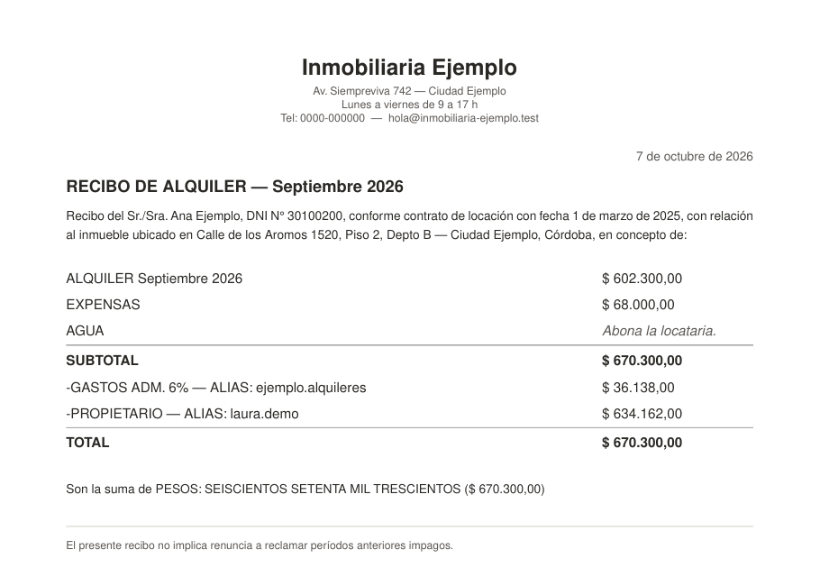

# Contrata: rental contract management system

SaaS for real estate agencies, born from a system built for Giordano Conti Inmobiliaria
(Río Cuarto, Argentina), where it manages 300–400 active rental contracts in production.

**Product site:** https://gestorcontratos.pb-devhouse.com/
*Source code is private (client project). This repo documents the architecture and decisions.
All screenshots use made-up test data: no real tenants, owners, amounts or addresses.*

## The problem
Contracts, rent increases and receipts were handled in spreadsheets. Every increase by
official indexes (ICL, IPC, Casa Propia) was calculated by hand, contract by contract, and
late fees were computed "when someone remembered".

## The solution
- Centralized contracts with tenant, guarantors, owner, dates, amounts, fees and extra charges
- A payment calendar generated automatically for the whole contract term
- Rent increases by official index (ICL, IPC, Casa Propia), fixed percentage or fixed amount, on the contract's own cycle (monthly, quarterly, every 4 or 6 months, yearly)
- Index values fetched automatically from official sources on a schedule
- Late fees (fixed per day or daily percentage) and a portfolio-wide view of unpaid months
- Receipts for tenant and owner, generated as PDF and DOCX with the agency's branding
- Dashboard and statistics with the agency's key numbers

## Two versions of the same system

| | v1: client system | v2: Contrata (SaaS) |
|---|---|---|
| Stack | Django REST Framework + React (Vite, Chakra UI) + PostgreSQL | Next.js (App Router, TypeScript) + Supabase (PostgreSQL, Auth, Storage, Edge Functions) |
| Tenancy | One agency (Giordano Conti) | Many agencies, isolated by Row Level Security |
| Status | In production since 2026 | Generalization of v1, sold in two plans (Lite / Pro) |

### v1: Django REST + React

### v2: Next.js + Supabase (multi-tenant)

## My role
Built with Tiago Pescara at PB DevHouse. I own the v1 repository and worked on both versions,
mostly on the backend and data side:

**v1 (Django REST, in production)**
- Multi-user support: separating contracts per user so the API only returns each account's data
- Contract endpoints, file uploads to Cloudinary, and fixes to contract creation and DOCX receipts
- Increase logic: manual override of a single month's rent, increases chained correctly on top of a manual adjustment, and a guard so already-applied increases are not re-applied
- Payment attachments per month and add/subtract adjustments on both receipts (tenant and owner)
- The Giordano Conti receipt layout
- Code health: repaired a test suite that had been broken for months, added a "golden fixture" test to prove the API returns the same data before and after a refactor, removed an N+1 query from the contract list, and added a `seed_demo` command
- Security cleanup: removed hardcoded credentials, protected maintenance endpoints with a shared token, prepared secrets for rotation, and handled a production incident (a misconfigured `DATABASE_URL` and a `main` branch that had never been deployed)

**v2 (Next.js + Supabase)**
- Manual and automatic rent increases and late fees (UI + database functions), including applying overdue cycles in order when an old contract is loaded
- The three Edge Functions that fetch IPC, ICL and Casa Propia, scheduled with `pg_cron` and restricted to the `service_role`
- Statistics page, and closing an RLS gap in the increase history table
- An account "kill switch" (`perfiles.activo`) enforced on every request
- A 10-phase QA plan (functional parity with v1, responsive, cross-browser, accessibility contrast) and the fixes it found: Argentina time zone for "today", rounding bugs, invalid IDs returning 500
- Visual system (brand palette, typography) and the pnpm-only tooling rule after a mixed npm/pnpm install broke the build

Tiago built most of the v2 scaffold and schema, the Pro plan (tenant panel, payment proof inbox, tenant portal), the public property site and the AI-assisted contract upload.

## Technical challenges

**Modeling contracts and their increase periods.**
A contract generates one row per month for its whole term. Each month keeps a base amount and a
final amount (rent + extra charges + VAT + late fee). An increase is applied from a given month
forward and every change is written to an append-only history (type, index, percentage, old
and new amount). Cycles are identified by the month they start in, not by percentage, so two
cycles with the same rate can't be confused. Months already paid are never touched, and when a
user hasn't logged in for a while, overdue cycles are applied one by one in order, not merged.

**Fetching and applying indexes automatically.**
Scheduled jobs pull IPC (INDEC), ICL (BCRA) and the Casa Propia coefficient from official
sources into their own tables. The increase for a cycle is the variation of the index across
that cycle's window. Official sources publish 2–4 weeks late, which left most cycles "blocked"
for weeks. I added a controlled substitution: if only the most recent month is missing, it is
filled with the last published value (never chaining two substitutes), the user sees a warning
naming the late source before confirming, and the reason is stored in the history. Automatic
bulk application stays strict and stops at incomplete data.

**Generalizing a single-client system into a SaaS.**
v1 assumed one agency: branding, fees and receipt texts were hardcoded. In v2 every table has
an owner and isolation is enforced in PostgreSQL with Row Level Security, so even a bug in the
app can't leak another agency's data. Branding (logo, contact info, legal text, default fees
and VAT) moved to a per-agency profile. Four receipt endpoints that had drifted apart in v1
became one route handler with a shared data builder. Plans (Lite / Pro) are a column on the
profile checked by RLS; the route guard and the menu are only UX on top of it.

## Screenshots

**Contract list**

**Contract detail: monthly calendar with applied increases**

**Rent variation with each index-based increase**

**Unpaid months across the whole portfolio**

**Generated receipt (PDF)**

